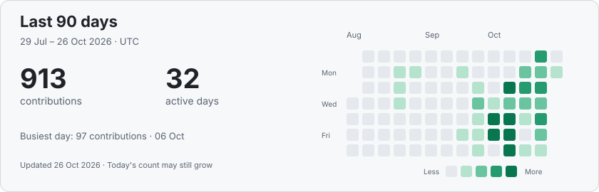

# Karthik Bala

**Technology leader · Tech entrepreneur · Enterprise AI strategist**

I build enterprise products that connect AI, data and operational workflows. With 20 years in software engineering and technology entrepreneurship, my work has spanned commerce platforms, supply chain systems, warehouse automation and applied AI.

I stay hands-on in architecture and engineering while leading teams from product concept through delivery, scale and ongoing operation.

<!-- ACTIVITY:START -->
## Last 90 days

**Current focus:** [Warehouse design](https://github.com/karthikbala/aislewise-showcase) · [Contract intelligence](https://github.com/karthikbala/ace-contract-intelligence-showcase) · [Logistics and tracking](https://github.com/karthikbala/container-sourcing)

Updated daily from GitHub's public contribution calendar, including anonymized private counts you choose to share. Repository names and private content are not collected. Counts follow GitHub's contribution rules.
<!-- ACTIVITY:END -->

## Products I work on

| Product area | Selected work |
| --- | --- |
| **Warehouse design and engineering** | [Aislewise](https://github.com/karthikbala/aislewise-showcase): AI-assisted warehouse planning, deterministic calculations, interactive 2D/3D scenes, scenario comparison and human review. |
| **Enterprise contract intelligence** | [ACE](https://github.com/karthikbala/ace-contract-intelligence-showcase): bilingual document intelligence, source-cited drafting, agreement-scoped access and approval workflows. Includes an ADNOC-focused demonstration using synthetic records. |
| **Logistics and tracking** | Container discovery, terminal data collection and structured tracking workflows. [Public container-sourcing tooling](https://github.com/karthikbala/container-sourcing). |
| **Retail and property intelligence** | Product and property collection, normalized data APIs, search and operational workflows across private application repositories. |
| **Commerce and supply chain** | Order management, inventory, warehouse operations, fulfillment and logistics platforms, through product architecture and engineering leadership. |

The Aislewise and ACE links are public product and architecture case studies. Their application source and client-specific materials remain private. Aislewise planning outputs require engineering validation; ACE's demonstration is distinct from client production acceptance.

## Public integrations and tools

- [Hyperpure MCP](https://github.com/karthikbala/hyperpure-mcp): procurement search, cart preparation, order history and invoices, with manual payment.
- [Zomato MCP](https://github.com/karthikbala/zomato-mcp): a self-hosted, read-only integration for restaurant orders, sales and availability.
- [Inventory replenishment](https://github.com/karthikbala/automatic-inventory-replenishment): Python-based replenishment and forecasting.

## Engineering leadership

As CTO at Rozana, I contribute through technology direction, architecture, prioritization and engineering leadership across commerce and supply chain products. Selected public work from the engineering teams includes:

- [API Automation](https://github.com/rozana-dev/API-Automation): TypeScript API testing with Axios, Mocha and CI workflows.
- [Rozana Playwright](https://github.com/rozana-dev/rozana-playwright): browser automation, reusable fixtures, cross-browser testing and diagnostic artifacts.

Implementation credit belongs to the respective engineering teams. These links represent my leadership contribution alongside the products I build directly.

## Technical focus

Enterprise architecture · LLM orchestration and RAG · AI agents and MCP · Document intelligence and OCR · Data engineering · Commerce and supply chain systems · Cloud infrastructure

Python · TypeScript/JavaScript · React · Flutter · PostgreSQL · Browser automation · Tauri/Rust

[LinkedIn](https://www.linkedin.com/in/karthikbalait/)
